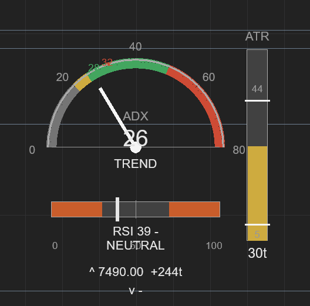

# GaugeCluster

A NinjaTrader 8 indicator that draws a small instrument cluster directly on the chart's price panel: an **ADX speedometer**, an **RSI slider**, an **ATR thermometer**, and the day's **price levels**: the four things a scalper otherwise reads out of a text HUD or a stack of sub-panels.

It is display-only: it never trades, never places or modifies orders, and shares no state with any strategy. It was built as a visual companion to the author's ES/MES scalping strategy (CoverRunnerScalper, private): the gauges use the same indicator periods and the same thresholds as the strategy's entry gates, so what the dial shows is what the strategy is acting on.

v1.0 by Muse Spark (Meta); v1.1 revisions by Vibe (Mistral AI).

## Why three different shapes

Each gauge is drawn in the shape its number actually means:

- **ADX is a speedometer** (0-80 scale). Trend strength is a "how fast are we going" quantity: one direction, more is more. Zones: 0-20 grey, 20-25 amber, 25-50 green, 50-80 red, with a needle, a digital readout, and small ticks at **28** and **32**. The regime label states which of the strategy's engines are live at this ADX: SWEEP ONLY (below 20), TREND (20-28), TREND+MOM (28-32), TREND (SWEEP OFF) (32-50), VERY STRONG (50+). Uses ADX(14).
- **RSI is a horizontal slider** (0-100). RSI's information lives at *both* ends: oversold below 30, overbought above 70, neutral between. Both extreme zones are coloured, and the marker and readout take the hot colour inside either extreme. The 30/70 boundaries are the strategy's chase guards: no trend shorts below RSI 30 (don't sell capitulation), no trend longs above 70 (don't chase exhaustion). Uses RSI(7, 3), the same parameters the strategy runs, so the gauge and the strategy's HUD always agree.
- **ATR is a vertical thermometer** (0-60 ticks). Volatility is a magnitude that fills up toward a limit, so the mercury rises: green below 22t, amber 22-38t, red above, and grey when the tape is dead. Two hard lines are drawn across the column: the **44-tick ceiling** (above it, entries are vetoed for excessive volatility) and the **5-tick floor** (below it, the tape is too quiet for an entry). The gauge prints **LOCKED HIGH** or **LOCKED LOW** on the appropriate side: a silent gate, made visible both ways. Uses ATR(14).

The speedometer's marks come straight from the strategy: the grey/green boundary at 20 is the trend engine's minimum ADX, the green tick at 28 is where momentum mode engages, and the red tick at 32 is where the reversal (sweep) engine stands down.

## Levels

GaugeCluster reads the same daily levels XML the strategy (and the author's price-marker indicator) reads: `<Level value="7730.25"/>` elements, prices only. It:

- draws each level as a line across the panel with a price tag,
- shows the **nearest level above and below** the last close, with the distance in ticks (`^ 7600.00  +435t` / `v 7490.00  -5t`),
- **reloads automatically** when the file's write time changes (the file is regenerated before the open), and ignores files older than yesterday.

One honesty note: the strategy additionally session-tags the levels file and rejects files dated in the future; this gauge keeps the simpler write-time freshness rule. Treat the lines as a display aid, not the strategy's guard of record.

Why a file and not the strategy's settings? NinjaTrader keeps strategies and indicators sealed off from each other: an indicator cannot read a running strategy's parameters. The levels don't live in the strategy anyway; they live in the file, so the indicator reads the file itself, through its own **Levels File Path** setting.

## Position and scaling

- **Position** anchor: TopLeft, TopRight, MiddleLeft (default), MiddleRight, BottomLeft, BottomRight: the cluster moves as one unit.
- **Offset X / Offset Y**: pixel margin or nudge from the anchor.
- **Auto-scaling**: the layout was designed on a ~1900x950 panel and scales proportionally with the actual chart panel (clamped 0.40x to 1.25x). Resize the chart and the cluster follows.
- **Size %**: a manual multiplier (40-200, default 100) on top of the automatic scaling.

## Settings

| Setting | Default | Notes |
|---|---|---|
| Levels File Path | `C:\NinjaTrader 8\Levels_ES.xml` (author's setup) | Point it at your own levels file; leave blank to skip levels |
| Position | MiddleLeft | Cluster anchor on the price panel |
| Offset X / Offset Y | 16 / 16 | Pixels from the anchor |
| Size % | 100 | Manual size multiplier over the auto-scaling |

## Setup

NinjaTrader 8, any chart and instrument:

1. Save `GaugeCluster.cs` into `Documents\NinjaTrader 8\bin\Custom\Indicators` (any subfolder of it).
2. Press **F5** in the NinjaScript Editor.
3. Add **GaugeCluster** from the chart's Indicators dialog, and set the levels path if you use one.

Tweaks live at the top of the file: `AtrCeilingTicks` (44) and `AtrFloorTicks` (5) are the ES/MES profile's ATR entry limits; for an NQ/MNQ profile use 80 and 8. The engine ticks (28/32) are in the `engineMarks` array in the speedometer section of `OnRender`. Indicator periods are set where the series are created in `OnStateChange` (`ADX(14)`, `RSI(7, 3)`, `ATR(14)`).

## Changelog

**v1.1 (Nov 5, 2026)**

- Text rendering: one cached DirectWrite factory plus a TextFormat cache per (render scale, font size), instead of a new factory and format for every text call; everything is disposed on termination.
- ATR: 5-tick floor lock added (LOCKED LOW); the mercury greys out below the floor. LOCKED now shows both sides of the entry veto, not just the ceiling.
- ADX: engine ticks at 28 (momentum mode on) and 32 (sweep engine off); the regime label now states which engines are live instead of a generic "STRONG".
- Comments and defaults renamed from the retired QuickCoverScalper fork to CoverRunnerScalper; the default levels path is the author's.
- Readout glyphs switched to plain ASCII (`^` `v` `-`) so copy/paste through chat or an editor cannot mangle them.

**v1.0 (Nov 5, 2026)**

- Initial release: ADX speedometer, RSI slider, ATR thermometer with the 44t ceiling line, levels from XML with nearest-level readout. Replaces ADXSpeedo.

## Limitations

- Renders on the price panel only; values refresh on bar close, like the strategy it accompanies.
- Level price tags can overlap tags from other level-drawing indicators (e.g. a price-marker indicator) if both are on the same chart: the lines are at identical prices by design.
- ATR limits are constants: a chart running both MES and NQ panels needs separate copies with different constants if the LOCKED lines matter on both.
- The thresholds are ES/MES-centric: everything renders on any instrument, but the marks mean what they say only for the ES/MES strategy profile.

## Disclaimer

A charting aid, published for education and discussion. It displays indicator values and file data; it is not a trading system and not financial advice.
